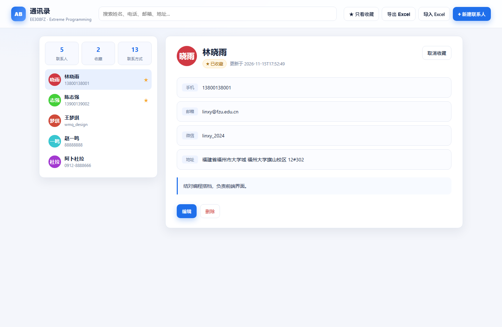

# 通讯录 Address Book — EE308FZ Extreme Programming 作业

福州大学 **EE308FZ 软件工程**（2601_FZU-MU_SE）极限编程作业的完整可运行实现。

**作业要求**：实现一个通讯录应用，支持 **收藏联系人**、**一人多种联系方式**、**Excel 导入导出**，
并通过 GitHub 仓库（≥3 次提交、Pull Request、Release）交付，发布一篇 CSDN 博客。
截止时间：**2026-11-17 23:59（北京时间）**。



---

## 1. 功能与评分点对照

| 评分项 | 分值 | 本项目实现 | 代码/验证位置 |
| --- | ---: | --- | --- |
| Markdown 格式博客 + GitHub / 代码规范链接 | 10 | `BLOG_DRAFT.md`、`docs/code-standards.md` | 本仓库 |
| 实现思路、程序截图、分工 | 20 | 见 `BLOG_DRAFT.md` 第 4、5、6 节 | `docs/screenshots/` |
| 页面风格 | 10 | 卡片式双栏界面、渐变/阴影、响应式、Toast、深链 `#id` | `static/style.css` |
| **收藏联系人** | 25 | 星标收藏、`只看收藏` 过滤、收藏优先排序、收藏计数 | `app.py::toggle_bookmark`、`app.js::toggleBookmark` |
| **多种联系方式** | 10 | 一个联系人可挂任意条：手机/邮箱/微信/QQ/地址/其他，可增删改 | `app.py::_clean_methods`、`app.js::addMethodRow` |
| **Excel 导入导出** | 25 | openpyxl 生成带样式的 xlsx（一行一人、一类一列）；导入按表头识别、按姓名去重合并 | `app.py::contacts_to_workbook` / `workbook_to_contacts` / `merge_imported` |
| 云端部署（加分 +15） | +15 | 代码与 `PORT` 环境变量已适配云主机，见第 8 节 | `app.py::main` |

---

## 2. 快速开始

环境要求：**Python 3.9+**（仅需 `openpyxl`，其余为标准库）。

```bash
cd FZU_EE308_XP_AddressBook
pip install openpyxl
python seed.py          # 可选：写入 5 个演示联系人
python app.py           # 默认 http://127.0.0.1:8000
# 或指定端口
python app.py --port 8123
```

打开浏览器访问 <http://127.0.0.1:8000> 即可使用。数据保存在 `data/contacts.json`，
删除该文件（再执行 `python seed.py`）即可恢复初始演示数据。

> Windows 用户也可以直接双击 `start.bat`。

---

## 3. 项目结构

```
FZU_EE308_XP_AddressBook/
├─ app.py                     # HTTP 服务 + 领域模型 + Excel 读写（核心，约 540 行）
├─ seed.py                    # 写入演示联系人
├─ start.bat                  # Windows 一键启动
├─ static/
│  ├─ index.html              # 单页结构（列表 / 详情 / 编辑弹窗）
│  ├─ style.css               # 页面样式（响应式、卡片、Toast）
│  └─ app.js                  # 前端逻辑（渲染、CRUD、导入导出、深链）
├─ tests/
│  └─ e2e_test.py             # 端到端验收脚本（27 项断言，覆盖全部评分点）
├─ tools/
│  └─ make_template.py        # 生成 docs/import_template.xlsx
├─ docs/
│  ├─ code-standards.md       # 代码规范（博客里要贴链接）
│  ├─ PSP.md                  # 个人 PSP 表
│  ├─ import_template.xlsx    # 导入模板（含示例行 + 填写说明 sheet）
│  └─ screenshots/            # 程序运行截图（home.png / editor.png）
├─ exports/
│  └─ address_book_export.xlsx# 导出的样例工作簿
└─ README.md
```

---

## 4. 核心设计

### 4.1 数据模型

```json
{
  "id": "c_ab45c98a2a",
  "name": "林晓雨",
  "bookmarked": true,
  "methods": [
    {"type": "phone",  "value": "13800138001"},
    {"type": "email",  "value": "linxy@fzu.edu.cn"},
    {"type": "wechat", "value": "linxy_2024"}
  ],
  "note": "演示数据",
  "createdAt": "2026-11-15T17:52:16",
  "updatedAt": "2026-11-15T17:52:16"
}
```

`methods` 用**一对多**结构而不是 `phone1/phone2/email1` 之类的并列字段，
新增一种联系方式只要在 `METHOD_TYPES` 里加一行，前后端与 Excel 列会自动跟随——
这是"一人多种联系方式"这一评分点最省事也最可扩展的做法。

### 4.2 HTTP 接口

| 方法 | 路径 | 说明 |
| --- | --- | --- |
| GET | `/api/health` | 健康检查 |
| GET | `/api/contacts?q=&bookmarked=1` | 列表（关键字 + 只看收藏） |
| POST | `/api/contacts` | 新建（重名 / 空姓名返回 400） |
| PUT | `/api/contacts/{id}` | 编辑（保留 createdAt） |
| DELETE | `/api/contacts/{id}` | 删除 |
| POST | `/api/contacts/{id}/toggle-bookmark` | 收藏 / 取消收藏 |
| GET | `/api/stats` | 联系人 / 收藏 / 联系方式数量 |
| GET | `/api/export` | 下载 xlsx |
| POST | `/api/import` | 上传 xlsx（裸二进制 body） |

### 4.3 Excel 格式

导出一行一个联系人、一类联系方式一列：

| 姓名 | 收藏 | 手机 | 邮箱 | 微信 | QQ | 地址 | 其他联系方式 | 备注 |
| --- | --- | --- | --- | --- | --- | --- | --- | --- |
| 林晓雨 | 是 | 13800138001 | linxy@fzu.edu.cn | linxy_2024 | | 福州市…12#302 | | 演示数据 |

- 同一人的多条同类信息用中文分号 `；` 分隔（例如两个手机号）；
- 导入按**表头名称**映射（`姓名/手机/邮箱/…` 或 `name/phone/email/…`），列顺序可打乱、多余列忽略；
- 导入按**姓名去重合并**：新姓名新增，已存在姓名只追加缺失的联系方式，不覆盖原有数据；
- 垃圾文件 / 缺 `姓名` 列 / 空表格都会返回 400 而不是崩溃。

---

## 5. 截图

| 主界面 | 新建/编辑弹窗 |
| --- | --- |
|  |  |

---

## 6. 测试

```bash
python app.py --port 8123          # 终端 1
python tests/e2e_test.py --base http://127.0.0.1:8123   # 终端 2
```

脚本会真实走一遍 HTTP：健康检查、列表、新建（含 4 种联系方式）、重名/空名 400、按姓名与电话搜索、
收藏开关与过滤、编辑、导出 xlsx 并用 openpyxl 校验表头与行内容、导入（新增 + 合并）、垃圾文件 400、
删除并还原基线。当前结果：**27 passed, 0 failed**。

---

## 7. Git 提交与发布流程

作业要求仓库至少 3 次提交、发布 Release 并提交 PR。本项目实际提交节奏如下：

```bash
git init
git add . && git commit -m "chore: project skeleton, code standards and data model"

git commit -m "feat(ui): two-column layout, search, toast and responsive styles"
git commit -m "feat(bookmark): star toggle, favourites-only filter and favourite-first ordering"
git commit -m "feat(api): contact CRUD with atomic JSON persistence"
git commit -m "test: 27 e2e assertions covering bookmark, methods and excel round-trip"
git commit -m "fix(import): only count contacts that actually changed as updated"

git tag -a v1.0.0 -m "Address book v1.0"
git push origin main --tags
```

在 GitHub 上从功能分支向 `main` 发起 Pull Request 并合并，然后 `Releases → Draft a new release`
选择 `v1.0.0` 发布。博客里需要贴出 commit 历史截图。

---

## 8. 云端部署（+15 分，可选）

程序只监听 `--host/--port`，可参数化，因此可直接跑在华为云 / 阿里云的 ECS 上（记得开安全组端口）：

```bash
# 云主机（Ubuntu 示例）
sudo apt update && sudo apt install -y python3-pip
pip3 install openpyxl
nohup python3 app.py --host 0.0.0.0 --port 80 > server.log 2>&1 &
```

或用 `PORT` 环境变量适配 PaaS（Render / Railway / 华为云容器等）：

```bash
PORT=8080 python app.py --host 0.0.0.0
```

Docker 方式：

```dockerfile
FROM python:3.11-slim
WORKDIR /app
COPY . .
RUN pip install openpyxl
ENV PORT=8000
CMD ["python", "app.py", "--host", "0.0.0.0"]
```

部署后把公网 `http://你的公网IP:端口` 填进博客"项目链接"一栏——注意 `localhost` 链接不算云部署。

---

## 9. 已知边界

- 单机 JSON 存储，适合课程演示；多实例并发写需换数据库。
- 未做登录鉴权，公网部署时请注意不要存放真实隐私数据。
- 导入按姓名去重：同名不同人会被合并，这是刻意简化（模板说明里也写明了）。

---

## 10. 许可

课程作业用途，可自由参考学习。
